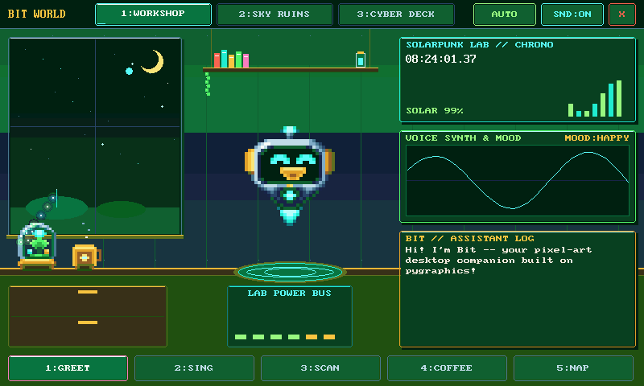

# Bit World

Bit World is a PyDevices app: Bit, a hovering robot, moves through three
pixel-art scenes drawn with pygraphics and scored with synthio, on
MicroPython-compatible boards and on CPython. It plays itself until you touch
it.

## On a board

Copy `apps/bit_world/` to `/apps/bit_world/` with mpftp, mpremote or any
file tool, leaving out `tests/` and `docs/`. Home shows it on the Desk page.
It needs a display and the pygraphics, audiodsp and multimer libraries, and
plays its music through the board's audio out when there is one.

Choosing it restarts the board into Bit World alone, so it has the panel and
the processor to itself. The X at the right of the stage bar, or Esc on a
keyboard, quits back to Home.

## Play it

Touch or click a tab to change scene, AUTO to stop or start the tour, and
SND to mute. On a keyboard, 1, 2 and 3 change scene, A or Tab toggles the
tour, M mutes, and Space and F are each scene's two actions.

[Roadmap](../../ROADMAP.md)

Made by [PyDevices](https://pydevices.com).
