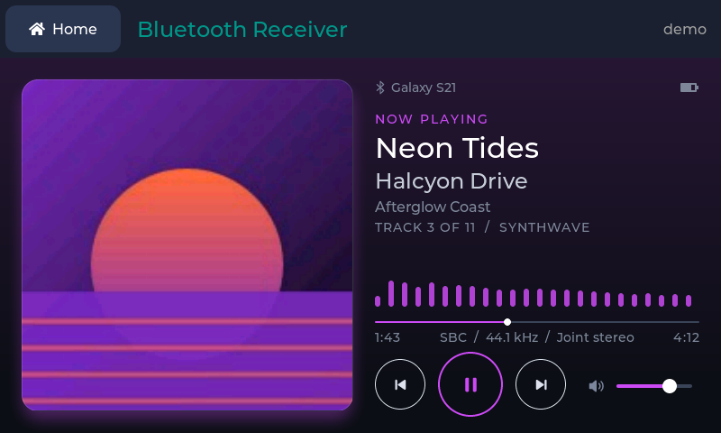

# Bluetooth Receiver

Bluetooth Receiver is a PyDevices app that makes the board a Bluetooth
speaker. Pair a phone or a computer with it and play anything. The screen
shows the cover large, and beside it everything the sender says: title,
artist, album, track number and count, genre, where the track is up to, and
the codec and rate of the stream. A line the sender leaves empty isn't shown.

## On a board

```python
import omip
omip.install("github:PyDevices/apps/apps/btreceiver")
```

Home shows it on the Audio page. It needs a firmware with `btclassic`, and
plays through the board config's `audio_out` on the audio pump. The spectrum
needs audiodsp's `audiometer`; without it the app plays with no spectrum.
Made for an 800 x 480 screen. The cover and its buffers take about 350 KB,
so it wants a board with PSRAM.

## Use it


Until something connects, the screen shows the name to choose in the phone's
Bluetooth list. Once paired, the phone is called back each time the app
opens. The buttons drive the phone's player: tap the middle one to play or
pause, the outer ones to skip, and hold an outer one to rewind or fast
forward. The slider is the phone's own volume, so either one moves both.
The phone's battery shows at the top right whenever the phone reports it,
amber when it runs low, and a weak signal is shown beside it.

Closing the app lets the phone go.

## On a computer

On a computer, with no `btclassic`, the app plays a demo: a pretend phone
that pairs, plays a few made-up tracks and follows the buttons. From this
repository's root, with the desktop `lvgl`, `svgio` and `jpegio` installed:

```bash
PYTHONPATH=lib python -c "import appkit; appkit.run('btreceiver')"
```

`BTRECEIVER_DEMO` holds the demo in one state (`pairing`, `idle`,
`playing`, `paused`, `nocover` or `long`), and
[`tools/shots.py`](tools/shots.py) saves a picture of each in a folder:

```bash
python apps/btreceiver/tools/shots.py shots
```

Made by [PyDevices](https://pydevices.com).
