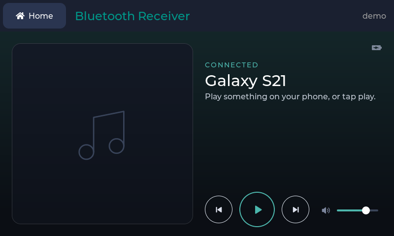
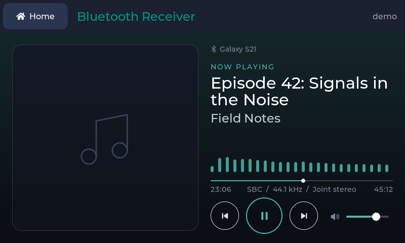

# Bluetooth Receiver

Bluetooth Receiver is a PyDevices app that makes the board a Bluetooth
speaker. Pair a phone or a computer with it and play anything. The screen
shows the cover large, and beside it everything the sender says: title,
artist, album, track number and count, genre, where the track is up to, and
the codec and rate of the stream. A line the sender leaves empty isn't shown.

## On a board

```python
import omip
omip.install("github:PyDevices/apps/apps/btreceiver")
```

Home shows it on the Audio page. It needs a firmware with `btclassic`, and
plays through the board config's `audio_out` on the audio pump. The spectrum
needs audiodsp's `audiometer`; without it the app plays with no spectrum.
Made for an 800 x 480 screen. The cover and its buffers take about 350 KB,
so it wants a board with PSRAM.

## Use it


Until something connects, the screen shows the name to choose in the phone's
Bluetooth list. Once paired, the phone is called back each time the app
opens. The buttons drive the phone's player: tap the middle one to play or
pause, the outer ones to skip, and hold an outer one to rewind or fast
forward. The slider is the phone's own volume, so either one moves both.
The phone's battery shows at the top right whenever the phone reports it,
amber when it runs low, and a weak signal is shown beside it.

Closing the app lets the phone go.

## Its other screens

Connected with nothing playing, the cover is a thin note and the play
button starts the phone's player. The battery here shows it charging.



Paused, the spectrum rests as a dashed line and the middle button turns
back to play.


A track with no cover gets the note in its place, and lines the phone
doesn't send, here the album and track number, are left out rather than
shown empty. This phone reports no battery, so none shows.



A long title wraps to a second line and pushes the details down, and a low
battery turns amber.


## On a computer

On a computer, with no `btclassic`, the app plays a demo: a pretend phone
that pairs, plays a few made-up tracks and follows the buttons. From this
repository's root, with the desktop `lvgl`, `svgio` and `jpegio` installed:

```bash
PYTHONPATH=lib python -c "import appkit; appkit.run('btreceiver')"
```

`BTRECEIVER_DEMO` holds the demo in one state (`pairing`, `idle`,
`playing`, `paused`, `nocover` or `long`), and
[`tools/shots.py`](tools/shots.py) saves a picture of each in
[`docs/images`](docs/images), where this page's pictures live:

```bash
python apps/btreceiver/tools/shots.py
```

Give it a folder first to save them somewhere else.

Made by [PyDevices](https://pydevices.com).
