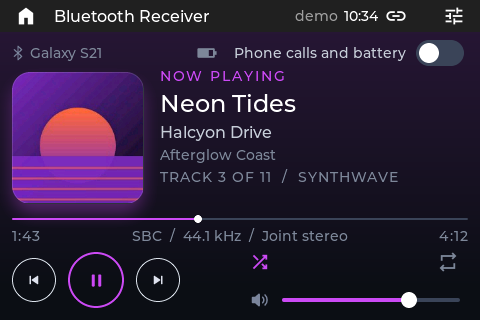
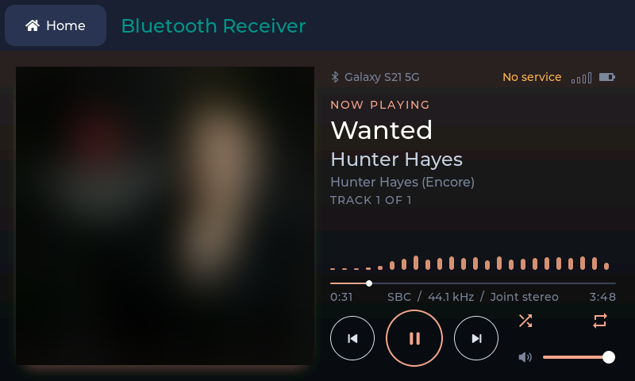
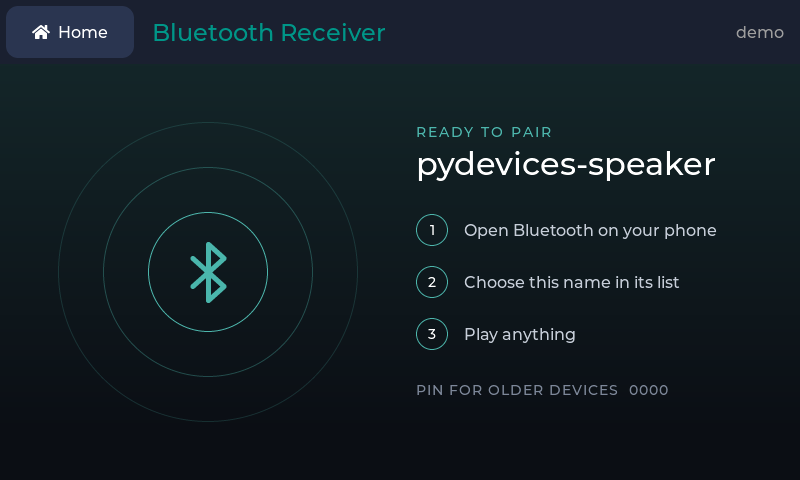
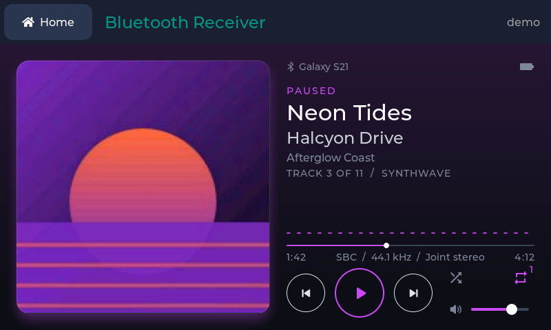
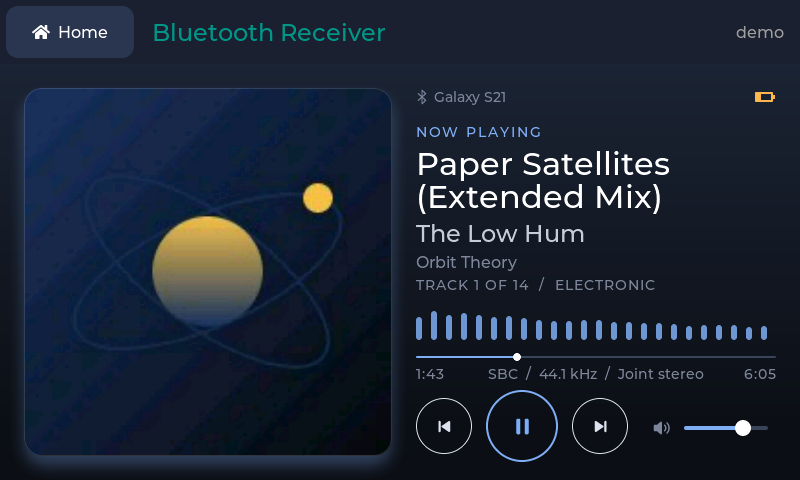
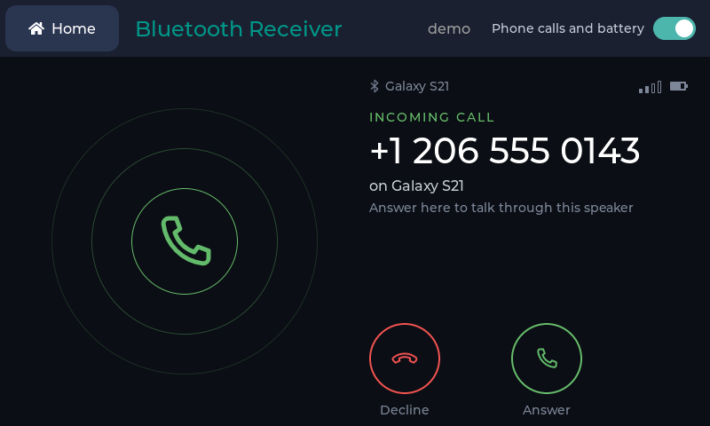
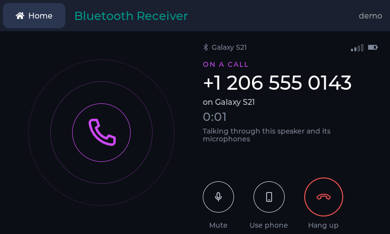

# Bluetooth Receiver

Bluetooth Receiver is a PyDevices app that makes the board a Bluetooth
speaker. Pair a phone or a computer with it and play anything. The screen
shows the cover large, and beside it everything the sender says: title,
artist, album, track number and count, genre, where the track is up to, and
the codec and rate of the stream. A line the sender leaves empty isn't shown.
With **Phone calls and battery** turned on, the board is also the phone's
hands-free unit: its battery and signal show at the top, and its calls show
on the screen.

## On a board

```python
import omip
omip.install("github:PyDevices/apps/apps/btreceiver")
```

Home shows it on the Audio page. It needs a firmware with `btclassic`, and
plays through the board config's `audio_out` on the audio pump. The spectrum
needs audiodsp's `audiometer`; without it the app plays with no spectrum.
The screen lays itself out for the display it's on. At 800 x 480 the cover
fills the left and the rest stacks beside it. At 480 x 320 and 320 x 240 a
smaller cover sits beside the track, and the progress line, the transport and
the volume run along the bottom. On a square or round screen everything
stacks down the middle, and the cover, then the album and track details, give
way when there's no room for them. The cover and its buffers take about
350 KB, so it wants a board with PSRAM.





Here it runs on an ESP32-S31 board with a 4.3-inch screen, with Phone calls
and battery turned on. The phone had no mobile service when this was
taken, so the status reads No service.

## Use it



Until something connects, the screen shows the name to choose in the phone's
Bluetooth list. Once paired, the phone is called back each time the app
opens. The buttons drive the phone's player: tap the middle one to play or
pause, the outer ones to skip, and hold an outer one to rewind or fast
forward. The slider is the phone's own volume, so either one moves both.
Above it, shuffle and repeat show the modes of the phone's player: tap
shuffle to turn it on or off, and repeat to go from off to all tracks to one
track, marked with a small 1. Each lights in the screen's colour while it's
on, and follows the phone when you change it there. A phone that doesn't
report them shows neither.

The phone's battery shows at the top right whenever its player reports it,
amber when it runs low, and a weak Bluetooth link is noted beside it.

## Phone calls and battery

The switch at the top right, **Phone calls and battery**, is off until you
turn it on, on every board, and the board remembers it the next time the app
opens. Off, the board is a speaker and nothing more.

On, the board also connects as the phone's hands-free unit, the way a car
kit does. The phone's battery and its signal show at the top right while it's
connected, the battery amber when it runs low, and its calls show on the
screen ([Calls](#calls) below). The phone gives these over its hands-free
link, so allow Calls for the board in the phone's Bluetooth settings. A
computer has no hands-free side, and shows neither.

Closing the app lets the phone go.

## Its other screens

Connected with nothing playing, the cover is a thin note and the play
button starts the phone's player. The battery here shows it charging.


Paused, the spectrum rests as a dashed line and the middle button turns
back to play. Repeat here is on for one track.



A track with no cover gets the note in its place, and lines the phone
doesn't send, here the album and track number, are left out rather than
shown empty. This phone reports no battery, so none shows.


A long title wraps to a second line and pushes the details down, and a low
battery turns amber. This phone doesn't report shuffle or repeat, so the
volume sits beside the play button.



## Calls

Calls come to the board with Phone calls and battery turned on.



A call shows a card over the player with the caller's number, and the phone
pauses its music. Answer it on the card and the call plays through the
board's speaker while the board's microphones go to the phone; decline it
and the card goes.



While you talk, the card counts the call's time. Mute turns the board's
microphones off, Use phone takes the call back to the phone (and Use speaker
brings it back), and Hang up ends it. When the call ends the music plays
again where it was. The call's audio needs a board whose `pcm_in` records
while `audio_out` plays; on one that can't, you hear the caller but they
can't hear you, and the card says so.

On an ESP32-S31 board the call's audio stays on the phone for now, because
that chip's Bluetooth can't yet carry it reliably. The card still shows the
caller, and answers, declines and hangs up; you talk on the phone, and the
card says so. The same goes for any board whose `HandsFree.call_audio` is
False, such as the Pico W. On an ESP32-S31 board with the setting on, a
call made through an internet calling app on the phone can reset the board.

## On a computer

On a computer, with no `btclassic`, the app plays a demo: a pretend phone
that pairs, plays a few made-up tracks and follows the buttons. From this
repository's root, with the desktop `lvgl`, `svgio` and `jpegio` installed:

```bash
PYTHONPATH=lib python -c "import appkit; appkit.run('btreceiver')"
```

`BTRECEIVER_DEMO` holds the demo in one state (`pairing`, `idle`,
`playing`, `paused`, `nocover`, `long`, `incoming` or `call`), and
[`tools/shots.py`](tools/shots.py) saves a picture of each in
[`docs/images`](docs/images), where this page's pictures live:

```bash
python apps/btreceiver/tools/shots.py
```

Give it a folder first to save them somewhere else, `--size 480x320` for
another display size, and `--round` with a square size to see it as a round
screen shows it.

Made by [PyDevices](https://pydevices.com).
