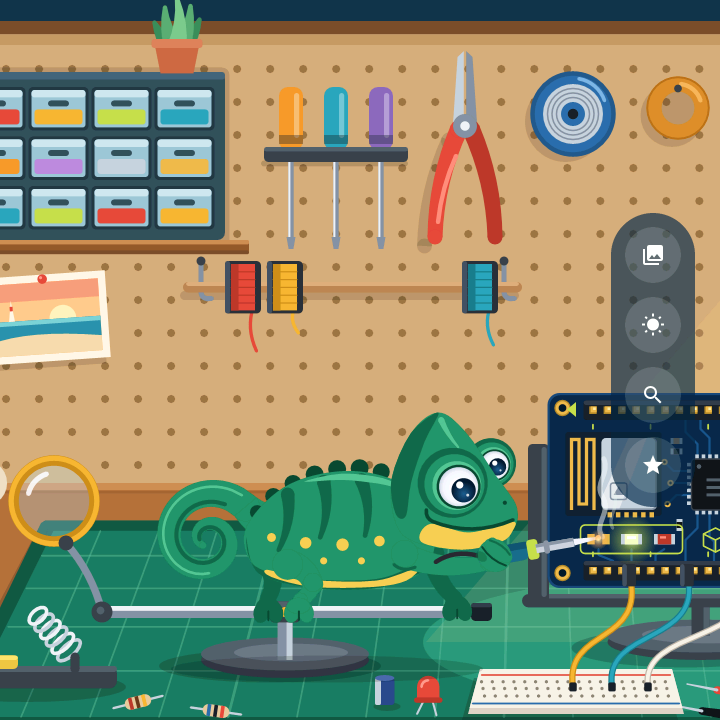

# Huey's Perch

Huey's Perch is a PyDevices app: Huey, a chameleon, at the coast, at a
workbench and on a desk. Every picture is vector art, shapes built in Python
and drawn by [svgio](https://github.com/PyDevices/micropython-pydevices/tree/main/modules/svgio)
at the size of your screen, so the same drawing fills a 240 x 240 round panel
and an 800 x 480 one. Huey walks, blinks, looks around, catches a bug and
changes colour with the season.

## On a board

```python
import omip
omip.install("github:PyDevices/apps/apps/perch")
```

Home shows it on the Desk page. It needs a display, LVGL and a firmware
whose `svgio` has `expand` and `Buffer`. Home leaves it out on an older
firmware, and opened there it says what its `svgio` lacks. Pictures are kept
in memory once drawn, about 8 MB on a 720 x 720 screen, so it wants a board
with PSRAM.

## Play it

Touch Huey and he answers. Touch anywhere else for four buttons:

- the next place: coast, workbench, desk
- the next season or time of day; at the workbench, Huey's next set of colours
- a closer view of the same drawing, then closer again
- something for Huey to do: a tongue shot, a stroll, a prop to hold, a turn to face you

## Draw your own

[`vec.py`](vec.py) is the drawing kit: circles, paths, limbs, groups and
gradients collected in a `Doc`, which svgio draws whole or through any view
rectangle. Each `scene_*.py` and [`huey.py`](huey.py) is a drawing written
with it. The scripts in [`tools/`](tools) render any of them to a picture on
a computer, with a MicroPython unix port that has svgio, and ffmpeg. This
writes `out/coast_huey_summer.png`:

```bash
cd apps/perch
mkdir out
tools/shoot.sh /path/to/micropython out coast_huey_summer
```

[Roadmap](../../ROADMAP.md)

Made by [PyDevices](https://pydevices.com).
