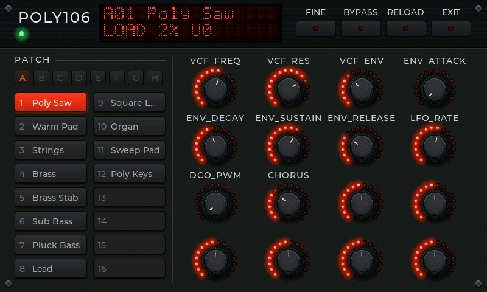

# synthstation

Synth Station is the PyDevices app that plays OmniPython's instruments from
a MIDI keyboard: audioinstruments' synthesizers, organs, pianos and drum
machines, one at a time, with the instrument panel to turn its knobs, on
MicroPython-compatible boards and on CPython.

## On a board

Copy the app and the libraries it imports to the board, with mpftp, mpremote
or any file tool:

- `apps/synthstation/` to `/apps/synthstation/`
- `lib/controlkit/` from this repository to `/lib/controlkit/`, and audioinstruments' `lib/audioinstruments/panel_view.py` beside it
- audioinstruments' `lib/` and `packages/midiports` from pydevices, to `/lib/`

It needs a display and an audio out, and a USB MIDI keyboard to play.

[Roadmap](ROADMAP.md)

## Play it

- **On a board with a USB host port** (an ESP32-S3 or ESP32-P4), plug in
  keyboards and controllers, through a hub if you like. Every one is heard
  at once, including one plugged in while the app runs.
- **On Windows or Linux**, every MIDI input port the computer has is heard:
  a USB keyboard, a loopback from a DAW or a sequencer. It needs
  [midiports](../midiports).
- **With no keyboard**, the panel says NO MIDI under the name, and the
  pads in bank A play notes: the kit's voices on a drum machine, two
  octaves of C major on anything else. The patches move to bank B.

Velocity, pitch bend and the instrument's own controllers go through.
Knobs that send controllers 30 to 41 move the first twelve macros: on a
Donner DMK-25 PRO, that's its four knobs in banks A, B and C. Controllers
70 to 77 (the MIDI spec's Sound Controllers 1 to 8, which many keyboards'
knobs send) move the first eight. The panel's encoders follow. Controller 7
on MIDI channel 1 sets the output's volume: slider S1 on the DMK-25 PRO. A program change picks the patch and lights
its pad. RELOAD builds the instrument again, keeping its patch and knobs.

Pads on MIDI channel 10 play a drum machine one sound per pad, from note 36
up, so every pad does something and none repeats: kick, snare, closed hat and
open hat come first where the kit has them, so a sound stays under the same
finger when you change kits, and pads past the kit's last sound are silent. SoundFont
Drums does this for whichever kit is playing. The keys, and any other channel,
still play General MIDI notes, so a song sent on channel 10 won't play the right
drums here.

Beside the drop-down, a small bar each for left and right shows what the board
sends the speaker, and a light flashes for every note that comes in over MIDI.
The light with no bars is a note the instrument doesn't sound; neither means
nothing arrived. The volume controller and the codec's volume don't move the
bars, because they come after the point the bars read.

The last instrument you played opens by itself. To change it, use the
drop-down in the panel's title bar, or a DMK-25 PRO's transport buttons:

| Button | Controller | What it does |
|---|---|---|
| Rewind | 16 | Previous patch |
| Fast Forward | 17 | Next patch |
| Stop | 18 | Previous instrument |
| Play | 19 | Next instrument |

Any keyboard that sends those controllers does the same. The sound stops
while the new instrument loads.

## The load readout

While nothing else is on it, the display's second line reads
`LOAD 42% U0`. LOAD is how long the last half second of audio took to
render, as a share of how long it lasts: under 100% keeps up, over 100%
can't. U counts the times the speaker ran out of audio since the
instrument was picked. Every five seconds the same figures, with the
slowest single block, go to the console:

```text
synthstation: poly106 load 87% peak 120% underruns 3 starved 40 ms
```

So the app doubles as a bench tool for an instrument on a slow board.

## Sound out

On a board whose `board_peripherals` publishes `AUDIO_OUT` with an I2S
wire, the audio pump plays the instrument on its own core, straight into
I2S, and the board's `audio_power` turns the codec on. Elsewhere it plays
through the board config's `audio_out`. Instruments run at 48 kHz stereo,
the rate they're designed and tested at.

## Tests

From this folder:

```bash
python -m unittest discover -s tests -p 'test_*.py' -v
```

They open, play and close every instrument with a stand-in keyboard and
speaker, on CPython and on unix MicroPython (`PYDEVICES_MICROPYTHON`
names one with LVGL and audiodsp).

Made by [PyDevices](https://pydevices.com).
