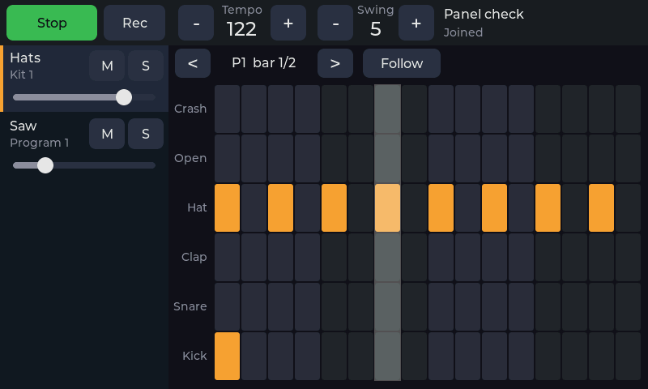

# Put Vamp on a board

Vamp plays Ostinato's songs: the sound and the song on one MicroPython, an
ESP32-P4 board or a desktop interpreter, with the screens somewhere else.
Ostinato's window and a browser page edit the song it plays, live, over
[hmilink](https://github.com/PyDevices/omnipython/tree/main/hmilink). A MIDI
keyboard on the board plays the selected track.

You need the [apps repo installed](../get-started/install.md), a General MIDI
SoundFont, [mpftp](https://github.com/PyDevices/mcuctl) installed, and a clone
of [omnipython](https://github.com/PyDevices/omnipython) beside the apps repo, where
`tools/vamp_files.py` finds hmilink (`--hmilink DIR` names it otherwise).

## On a board

Copy the files, with the board's port or address:

```bash
python tools/vamp_files.py COM4
```

That puts `vamp`, `songmodel` and `hmilink` into `/lib` and a song at
`/vamp_song.json`; `--song FILE` picks a different song. Put the SoundFont on
the SD card at `/sd/soundfonts/GeneralUser-GS.sf2`, or on the board in
`/soundfonts` or `/data/soundfonts`. Then, on the board:

```python
import vamp; vamp.run()
```

## On a desktop MicroPython

With the apps repo's `programs/` and `lib/`, hmilink, audioinstruments' and audioeffects' `lib/` and omnipython's `lib/`
on `MICROPYPATH`:

```bash
micropython -X heapsize=96M -m vamp.main --bank GeneralUser-GS.sf2 --song programs/ostinato/songs/sketches/soundfont_check.json
```

## Open a panel

Browse to `http://HOST:9100/` for the browser panel, join with
[a touch screen](#a-touch-screen-as-the-panel), or join with Ostinato's
window, from `programs/ostinato`:

```bash
python -m ostinato --connect HOST:9100
```

Every panel sees the same song, and an edit on one shows on the others while
the box keeps playing. The options (`--port`, `--midi`, `--lookahead-ms`,
`--seconds`) are listed at the top of [`programs/vamp/main.py`](../../programs/vamp/main.py).

## A touch screen as the panel



A board with an 800x480 touch screen can be the box's front panel, and so can a
desktop window. It shows the selected track's pattern a bar at a time: press a
step to put a note there or take it away, and the lit column is where the box is
playing. M and S mute and solo a track, the slider is its volume, and Rec then
Play records what the box's keyboard plays into the selected track.

On a board with LVGL and its display's board config, copy the panel's files and
start it with the box's address:

```bash
python tools/vamp_files.py COM17 --panel
```

```python
import vamp; vamp.run_panel("HOST")
```

The board joins the Wi-Fi network it already knows before it looks for the box.
With no router, the panel's board can be the access point instead: start it with
`vamp.run_panel("192.168.4.2", "--ap", "NAME", "PASSWORD")`, join the box's board
to that network, and start the box. The first board to join gets 192.168.4.2.

In a desktop window, with `omnipython-desktop` and `omnipython-lvgl` installed
and the apps repo's `programs/` and `lib/` and hmilink on `PYTHONPATH`:

```bash
OMNIPYTHON_WIDTH=800 OMNIPYTHON_HEIGHT=480 OMNIPYTHON_SCALE=1 python -m vamp.panel_main --box HOST:9100
```

## Record a take

Arm a track in a panel and press Record with Play, and the box writes what
the keyboard on its USB host port plays into that track's pattern: on the
sixteenths when the song's quantise is on, replacing the pattern when overdub
is off, and skipping notes played in a count-in.

To try it without a keyboard on Windows, run `python -m midiports.loopback` to
make a MIDI loopback port (`midiports.LOOPBACK`, which needs Windows MIDI
Services), and play into it from any program. [`tools/vamp_midi_loopback_check.py`](../../tools/vamp_midi_loopback_check.py)
does that: it runs the box on MicroPython for Windows, plays a known phrase
into the loopback from a second process, and compares the notes in the song
with what was played.

## Check that a box is behaving

[`tools/vamp_link_check.py`](../../tools/vamp_link_check.py) drives a running
box, on a board or the desktop, the way a panel does. With `--browser` it
drives the page in Chromium too.
