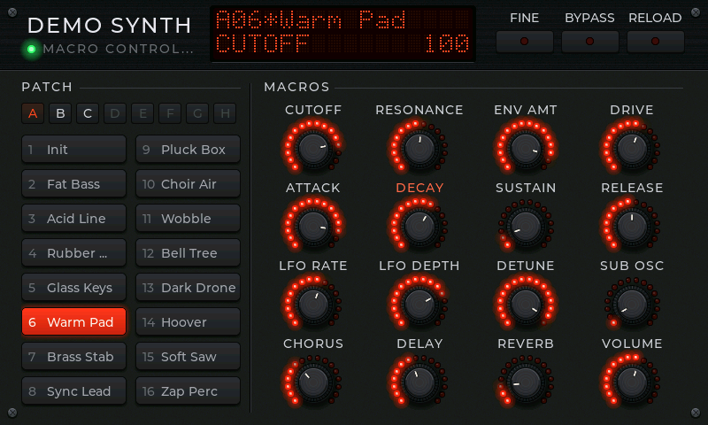

# controlkit

The shared controls for every PyDevices app that draws a front panel: the
encoder with its LED ring, the dot-matrix display, the sixteen patch pads,
the slider with an optional lamp, the LED segment meter, the lamp button and
the illuminated pad grid. They are drawn in LVGL on MicroPython-compatible
boards, CircuitPython-compatible boards and CPython, and they import nothing
from any app.

A panel is a layout of these controls. The layouts live with the code that
edits through them:

- `audioinstruments/lib/audioinstruments/panel_view.py` lays out the panel
  for an instrument;
- `audioeffects/lib/audioeffects/panel_view.py` does the same for an effect.

Each file imports `controlkit` and LVGL inside a guard, so it loads on a host
with neither, and `build()` raises ImportError there. A host with its own
control surface never needs this package.

## The controls

| Control | Module | What it is |
|---|---|---|
| `Encoder` | `encoder` | One endless encoder: a knurled cap, a pointer, and sixteen LEDs in a ring |
| `DotMatrix` | `dotmatrix` | The dot-matrix display, one line of text per row |
| `Slider` | `slider` | A fader, vertical or horizontal, with an optional lamp |
| `LedMeter` | `meter` | A column or row of lit segments, green, amber and red |
| `LampButton` | `lamp_button` | A labelled push button with a coloured lamp, momentary or toggle |
| `PadGrid` | `pad_grid` | A grid of illuminated pads, each lit in any colour |
| `Lamp` | `_draw` | An indicator LED, the lamp the encoder and the buttons use |

Every control takes a theme, a parent and coordinates in its parent. The
slider, the meter, the lamp button and the pad grid each have a short
docstring that says what the host calls.

```python
from controlkit import LampButton, LedMeter, PadGrid, Slider
from controlkit.theme import BLACK

slider = Slider(screen, 20, 20, 60, 200, BLACK, legend="Cutoff", led=True,
                on_change=lambda s, value: print("cutoff", value))
slider.set_led(0xFF2814)

meter = LedMeter(screen, 100, 20, 30, 200, BLACK, segments=16, legend="Out")
meter.set_level(0.6)

grid = PadGrid(screen, 20, 260, 320, 120, BLACK, cols=8, rows=2,
               on_press=lambda g, index: print("pad", index))
grid.set_color(3, 0x00FF00)
```

## Themes

`theme.py` holds every colour the controls draw, in a plain dict. `BLACK` and
`SILVER` are built in. Copy one, change what you like, and pass it as
`theme=`; any key you leave out comes from `BLACK`.

## The adapter a panel edits through

The panel edits through an adapter, an object you write that knows your
instrument. It needs these attributes and methods:

| | |
|---|---|
| `script_name` | The name on the faceplate |
| `macro_labels`, `macro_count` | Up to 16 labels, and how many of the 16 encoders are in use |
| `macro_values` | The 16 current values, MIDI 0 to 127 |
| `patches`, `patch_index` | Patch names (up to 128, so up to eight banks of 16) and the current one; an empty list hides the pads |
| `bypass`, `engine_ready`, `engine_error` | What the engine light and the display report |
| `set_macro(index, value)`, `set_patch(index)` | The user turned an encoder or pressed a pad |
| `set_bypass(enabled)`, `request_reload()` | The BYPASS and RELOAD buttons |
| `on_external_change(callback)` | Register `callback(kind, index, value)` for changes from elsewhere |

Call the callback with `("macro", index, value)` when a host's automation or
a controller moves a macro, and `("patch", index, index)` when the patch
changes from outside. The panel moves its encoders and pads to match and
publishes nothing back, so the two sides never chase each other. After a
patch change it reads `macro_values` again, so every encoder follows even if
your adapter reports only the patch.

`mock.py` here is a complete adapter with no sound, and the source to copy from.

## Play it

- Drag an encoder up or right to raise it, down or left to lower it. FINE
  makes a drag four times finer and the wheel step one at a time.
- Click an encoder, then use the wheel or the arrow keys. Quick notches turn
  it faster. Home and End go to the ends.
- With two wheels, one moves between the controls and the other turns the one
  that has focus. The appkit app sets this up on a desktop: scroll to move,
  tilt the wheel (or turn the thumb wheel) to turn. Pass `two_wheels=True` to
  `build()` for your own two-wheel setup.
- Double-click an encoder, or press Backspace, to return it to the value the
  patch gave it. An asterisk after the patch number on the display means the
  sound has been edited away from the patch.
- The bank buttons A to H show another bank's pads without changing the
  sound; a pad press picks the patch.

## Tests

From the apps repository's `tests/`:

```bash
python -m unittest discover -s tests -p 'test_controls.py' -v
python -m unittest discover -s tests -p 'test_panel_contract.py' -v
```

`test_controls.py` builds each control on a display with no window and
drives it by hand and by a host, on CPython and on unix MicroPython. Its
`--plant` run stops a slider reporting its changes, and that must fail.
`test_panel_contract.py` runs the instrument panel the same way. It needs
`AUDIOINSTRUMENTS_DIR`, a checkout of audioinstruments.

OmniPython is made by [PyDevices](https://pydevices.com).
