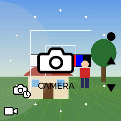

# Camera

Camera is a camera app for an ESP32-P4 board: photos, H.264 video with sound,
an album, the card as a USB disk, pedestrian and face detection, four screen
rotations and interval shooting. It is the ESP32-P4X-EYE's own camera app,
screen for screen, written as a PyDevices app so that other boards run it too.

Runs on: the ESP32-P4X-EYE, where it starts with the board, any other ESP32-P4
board as an app in Home, and desktop MicroPython at 240x240 or larger. A board
without one of the Eye's parts steps down to what it has; the USB camera source
is written and not yet run on a camera.
[What each board does](docs/how-it-works.md#what-a-board-needs).

## Try it on a desktop

You need desktop MicroPython with LVGL and the PyDevices libraries
(`bin/micropython` from micropython-pydevices). From this folder:

```
MICROPYTHON=path/to/micropython tools/run.sh
```

The picture is a test card with a figure walking across it. The keys stand in
for the board:

| Key | Board control |
|---|---|
| M | Menu button |
| Up, Down | Up and Down buttons |
| Enter, middle mouse button | knob press |
| `+` and `-`, mouse wheel | one knob detent left or right (three make a step) |
| S | card in or out |
| F | card full |
| U | a USB host on the upper port, or not |
| R | turn the board 90 degrees |

The mouse works as a touch screen too: click a Menu, Up or Down picture, click
the page for the knob press, and drag up or down to turn the knob.

`PYDEVICES_WIDTH` and `PYDEVICES_HEIGHT` pick a bigger panel. The layout is
drawn once at 240x240, enlarged by a whole number and centred, so
`PYDEVICES_WIDTH=720 PYDEVICES_HEIGHT=720 tools/run.sh` shows it at 3x.

## Put it on a board

The firmware is MicroPython from micropython-pydevices with `cameraif`, `ppa`,
`jpegio`, `h264enc` and `vision`. With your board's config installed, one line
at the board's REPL puts Camera in `/apps/eyecam`, where Home lists it, and
`mp4mux`, appkit and touchkit in `/lib`:

```python
import omip
omip.install("github:PyDevices/apps/programs/camera")
```

The app is about 1.4 MB with its pictures and fonts.
[Install an app](../../docs/guides/install-an-app.md) has the board config and
Wi-Fi lines that come first.

To have the board start in Camera, full screen, as the Eye does, make Camera's
`main.py` the board's:

```python
omip.install("github:PyDevices/apps/programs/camera/main.py", target="/")
```

Home's `main.py` takes the board back to Home
(`omip.install("github:PyDevices/apps/apps/home/main.py", target="/")`). Under
Home, on a panel bigger than the Eye's, a press held in the top-left corner
goes back to Home.

Pedestrian and face detection need two model files that the app doesn't
carry. Put them in `/sd/models` on the card: the
[model files page](../../docs/reference/models.md) has the downloads and the
names to save them as. Without them the AI page draws no boxes, and the REPL
says which file it looked for and where.

Docs: [how it works](docs/how-it-works.md). Examples: [the shot lists](tools).
Roadmap: [ROADMAP.md](../../ROADMAP.md).

The factory pictures are Espressif's, under the Apache licence, and the
fonts are KoHo, under the SIL Open Font Licence: see [NOTICE](NOTICE).

Made by [PyDevices](https://pydevices.com).
